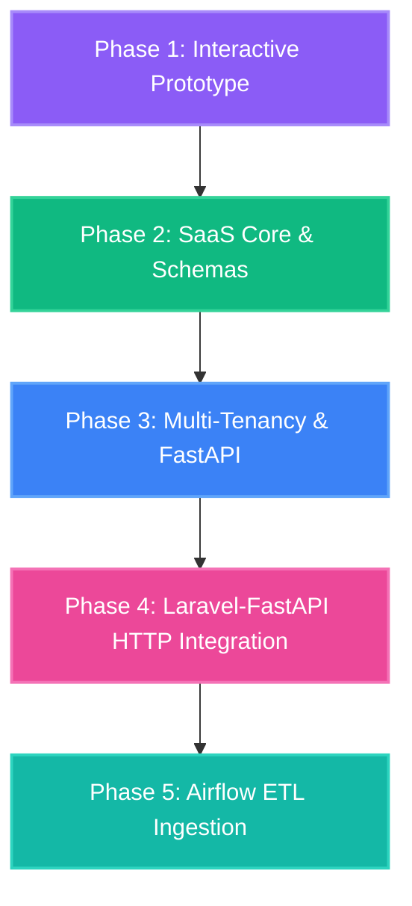

# StockSense AI - Predictive Inventory & Demand Forecasting SaaS

StockSense AI is a predictive inventory software designed for local retailers, regional distributors, and agricultural commodity traders to optimize working capital and minimize stockouts using machine learning forecasting.

---

## 1. High-Level Product Architecture

The system features a hybrid multi-tenant structure split into three primary layers:
- **SaaS Core & Tenant Layer:** Centralized Laravel 12 application handling user billing, vendor access control, notifications, and telemetry views.
- **Inference & Orchestration Layer:** Python FastAPI predictor service running LightGBM models inside Docker containers, triggered by Apache Airflow DAGs.
- **Data & Storage Lake:** PostgreSQL + TimescaleDB for transactional/relational records, Redis for task queue worker systems, and MinIO for tenant-isolated sales file uploads.

---

## 2. Directory Structure

```bash
├── prototype/              # Interactive Client Dashboard prototype (HTML/CSS/Vue)
├── app/                    # Laravel application backend models and logic
├── config/                 # Laravel system configuration files
├── database/               # Database seeders and migrations
│   └── migrations/         # Relational schemas & TimescaleDB hypertables
├── docker-compose.yml      # Local service orchestration configuration
└── README.md               # Main project documentation
```

---

## 3. Development Timeline & Phases (1 &rarr; 2 &rarr; 3 &rarr; 4 &rarr; 5)



### Phase 1: Client Dashboard Prototype [Completed]
A high-fidelity frontend representation to showcase predictive charts, alerts, and model observabilities.
* **Location:** [prototype/index.html](file:///d:/xampp/htdocs/StockSense%20AI/prototype/index.html)
* **Features:** Price Elasticity scenario slider, simulated POS csv uploader, WhatsApp alert trigger, and mock Airflow retraining log console.

### Phase 2: SaaS Core & Database Provisioning [Completed]
Setting up the relational database structures and container environments for local dev.
* **Codebase:** Laravel 12 project setup.
* **Local Services:** Configured in [docker-compose.yml](file:///d:/xampp/htdocs/StockSense%20AI/docker-compose.yml) (PostgreSQL + TimescaleDB, Redis, and MinIO S3).
* **Migrations:** 
  - `tenants` & `suppliers` tables.
  - `products` (holding safety stocks, prices, lead times, and ML coefficients).
  - `pos_transactions` (converted into a partitioned **TimescaleDB hypertable** using pgsql driver hooks).

### Phase 3: Laravel Multi-Tenancy & FastAPI Predictor [Completed]
Initializing tenant database scopes and machine learning prediction engines.
* **Laravel Scoping:** Intercepts tenant headers (`X-Tenant-ID`) via [ResolveTenantContext](file:///d:/xampp/htdocs/StockSense%20AI/app/Http/Middleware/ResolveTenantContext.php) middleware and binds the active tenant context. Applies automatic global query filtering (`where tenant_id = X`) via the [BelongsToTenant](file:///d:/xampp/htdocs/StockSense%20AI/app/Models/Traits/BelongsToTenant.php) trait on model queries.
* **Python microservice:** Initialized virtual environment in [ml-service/](file:///d:/xampp/htdocs/StockSense%20AI/ml-service/). Coded [main.py](file:///d:/xampp/htdocs/StockSense%20AI/ml-service/main.py) with schemas and a predictive endpoint `/predict` POST that trains a `lightgbm.LGBMRegressor` on-the-fly and generates recursive forecasts and safety stocks.
* **Unit Tests:** `MultiTenantScopeTest` passing successfully.

### Phase 4: Laravel-FastAPI HTTP Integration [Completed]
Connecting the SaaS backend controllers directly with the ML forecasting microservice.
* **Controllers:** Implemented [ProductForecastController](file:///d:/xampp/htdocs/StockSense%20AI/app/Http/Controllers/ProductForecastController.php) (aggregates sales history and query connectors) and [POSIngestController](file:///d:/xampp/htdocs/StockSense%20AI/app/Http/Controllers/POSIngestController.php) (records transaction streams and evaluates safety limits).
* **API Endpoints:** Set up under [api.php](file:///d:/xampp/htdocs/StockSense%20AI/routes/api.php) (`GET /api/products`, `GET /api/products/{id}/forecast`, `POST /api/products/ingest`).
* **Integration Tests:** `ForecastIntegrationTest` mock HTTP responses validated successfully.

### Phase 5: Data Lake Ingestion & Airflow ETL [Completed]
Nightly data engineering pipelines and model retrain loops.
* **Orchestration:** Implemented [retrain_models_dag.py](file:///d:/xampp/htdocs/StockSense%20AI/airflow/dags/retrain_models_dag.py) using modern task decorator APIs. Coordinates POS extraction from S3, data quality validation checks via Great Expectations, Snappy-compressed Parquet compactions in MinIO, feature engineering (lags & elasticity), LightGBM model fits (Optuna), MLflow registries, and drift check loops.
* **Validation:** Verified via python compiler module with 0 compile errors.

---

## 4. Local Setup Instructions

### Step 1: Open the Frontend Prototype
Launch the prototype dashboard in any browser. Double-click the file or navigate to:
```text
file:///d:/xampp/htdocs/StockSense AI/prototype/index.html
```

### Step 2: Spin Up Infrastructure Services (Docker)
Start Docker Desktop on your system, open your terminal, and run:
```bash
docker compose up -d
```
This runs PostgreSQL on port `5432`, Redis on `6379`, and the MinIO object console on `9001` (user/pass: `minioadmin`).

### Step 3: Run Database Migrations & Tests
Verify Composer dependencies, run migrations, and execute the feature tests:
```bash
# Setup backend dependencies
composer install

# Copy environment template & generate keys (if needed)
copy .env.example .env
php artisan key:generate

# Build database schemas
php artisan migrate

# Run multi-tenancy tests
php artisan test --filter=MultiTenantScopeTest
```

### Step 4: Run the FastAPI Prediction Engine
Start the Python uvicorn server:
```bash
# Navigate to the microservice and start the predictor engine
cd ml-service
.venv\Scripts\python.exe main.py
```
The forecaster will start running at `http://127.0.0.1:8000`. You can query the POST endpoint `/predict` with SKU sales histories to generate live LightGBM models.

---

## 5. Decoupled Cloud Deployment (Render + Neon.tech)

If you are hosting the production or staging instances on Render and Neon:

### Step A: Setup Neon PostgreSQL Database
1. Create a free PostgreSQL database cluster on [Neon.tech](https://neon.tech).
2. Copy the Connection String (URI format).
3. Select your Laravel app environment variables and update:
   ```text
   DB_CONNECTION=pgsql
   DB_HOST=ep-example-1234.us-east-2.aws.neon.tech
   DB_PORT=5432
   DB_DATABASE=neondb
   DB_USERNAME=your_username
   DB_PASSWORD=your_password
   # Ensure SSL mode is enabled (required by Neon)
   DB_SSLMODE=require
   ```
*(Note: Since free Neon database clusters do not have the TimescaleDB extension enabled, the migrations will automatically log a warning and fall back to standard PostgreSQL relational tables without crashing).*

### Step B: Deploy FastAPI Predictor to Render
1. Create a new **Web Service** on [Render](https://render.com) connected to your GitHub repository.
2. Set the **Root Directory** to `ml-service`.
3. Set the **Runtime** to `Python 3`.
4. Set the **Build Command** to:
   ```bash
   pip install -r requirements.txt
   ```
5. Set the **Start Command** to:
   ```bash
   uvicorn main:app --host 0.0.0.0 --port $PORT
   ```
6. Render will assign a public URL, e.g., `https://stocksense-ml.onrender.com`.

### Step C: Deploy Laravel SaaS to Render
1. Create another **Web Service on Render** for the root folder of the project.
2. Select the **PHP** or **Docker** runtime.
3. Configure the environment variables to point to your Neon Database host.
4. Set the `FORECAST_SERVICE_URL` variable to point to your Render FastAPI URL:
   ```text
   FORECAST_SERVICE_URL=https://stocksense-ml.onrender.com
   ```
5. Run remote console migrations:
   ```bash
   php artisan migrate --force
   ```

---

## 6. Live Production Dashboard Integration

In the production cloud instance, the default Laravel welcome screen has been replaced with the **Live StockSense AI SaaS Dashboard**:
* **Live Server Access:** Visiting `https://stocksense-ai-0g8t.onrender.com/?tenant_id=tenant_001` will display the interactive dashboard.
* **Automatic Database Seeding:** The container automatically migrates and runs seeds idempotently on boot to populate a mock tenant (`tenant_001`), supplier, and demo products with 30 days of sales history.
* **Live Cloud Interactivity:**
  * `GET /api/products` retrieves stock levels directly from the Neon database.
  * `GET /api/products/{id}/forecast` dispatches live inputs to the FastAPI regressor to map forecasting matrices and recalculate safety margins.
  * **POS Checkout Terminal:** Exposes a full transactional cash register tab in the sidebar navigation. Cashiers can browse products, manage a cart with real-time tax/total adjustments, and checkout to write live transaction records and deduct inventory on the fly.
  * **POS Ingestion Simulation:** Clicking the CSV uploader fires a live POST query to `/api/products/ingest`, writing sales transactions to PostgreSQL in real-time and raising stockout alerts if safety thresholds are violated.
  * **Tenant CRUD Administration:** Exposes a secure RESTful API endpoint mapping (`/api/tenants`) to list, register, view, update, or terminate customer tenant subscription profiles (free, basic, premium) in the Neon cloud database.

---

## 7. Industry Standards & Design Patterns Followed

StockSense AI is built around modern software engineering, data, and ML engineering standards:
* **Multi-Tenant Logical Isolation:** Restricts data access strictly to authenticated tenants via global Eloquent scopes (`TenantScope`) and traits, preventing cross-tenant data leaks.
* **Time-Series Database Optimization:** Configures `pos_transactions` as a partitioned TimescaleDB hypertable for optimized time-series calculations.
* **Separation of Concerns (Microservices):** Decouples inventory management (Laravel 12) from mathematical forecast prediction calculations (Python FastAPI).
* **Enterprise MLOps Orchestration:** Runs automated Apache Airflow retraining loops incorporating Great Expectations (schema check), Parquet file compaction, MLflow tracking, and drift observables.
* **Protocol-Agnostic Assets:** Employs relative URL path bindings for static CSS and JS modules to bypass Mixed Content blocks behind reverse proxies.

---

## 8. Advanced Platform Upgrades

Recently, StockSense AI underwent four core enterprise production upgrades:

### A. POS Offline Resiliency & Print Receipts
- **Client-Side Storage Caching:** Integrated connection monitoring (`navigator.onLine`). If network connectivity drops, POS checkouts are cached in `localStorage` and automatically synchronized to the cloud on recovery.
- **Synthesized Audio Engine:** Built a Web Audio API sound generator playing high-fidelity cashier beeps for successful scans and buzzer alerts for offline/connection errors.
- **Printer-Friendly Receipts (`@media print`):** Flat CSS page resets block height constraints to render clean thermal cash receipts in print preview.

### B. Smart SKU Suggestions & Autocomplete
- **Real-Time SKU Lookup:** Displays a suggestions list matching SKU codes or names as user types in the POS search bar.
- **Zero-State Fallback:** Clicking the empty input displays the top 5 in-stock products for rapid selection.
- **Keyboard-Only Terminal Navigation:** Managers can navigate selections with arrow keys and hit `Enter` to checkout entirely mouse-free.

### C. SaaS Admin Control Panel Separation
- **Dedicated Route Isolation:** Moved tenant registration, subscription levels, and context switcher database scopes out of cashier layouts into a secure `/saas-admin` URL route.
- **Bilateral Workspace Links:** Included quick links to switch between cashier and admin terminals in the sidebar footer.

### D. Multi-Model Forecast Overlays & Drift Autorecovery
- **Algorithm Comparison Graph:** Plots LightGBM, Prophet (seasonal Fourier), and LSTM (deep learning recurrent) forecasting lines on Chart.js simultaneously. The selected active model is highlighted bold while overlay models display transparently.
- **MLOps Drift Autorecovery Panel:** Allows setting a drift tolerance threshold. If simulated model drift exceeds this limit, the system automatically triggers the retrain DAG, streams logs, and reduces drift back to a 0.8% baseline.