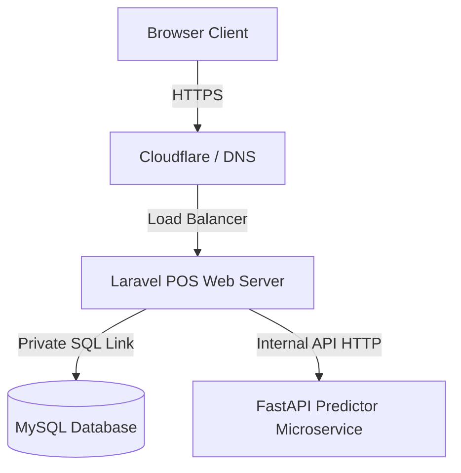

# Production-Grade Enhancements & Customer Handover Plan

This document details the enterprise-grade upgrades built into **StockSense AI** and outlines the deployment, provisioning, and client onboarding blueprint for a successful handover.

---

## 1. Production-Grade Enhancements Log

The application has been refined with robust architectural systems that elevate it from a prototype to a secure SaaS product:

### A. Strict Data Isolation (Multi-Tenancy)
* **Model Scoping Traits**: The `BelongsToTenant` model trait automatically hooks into Eloquent model events to inject tenant IDs during creation.
* **Global Query Filters**: The `TenantScope` filter intercepts all queries on scoped resources (Products, Suppliers, POS Shifts, Transactions, Purchase Orders) to guarantee a tenant can never view or manipulate another client's records.

### B. Enterprise Subscription Tier Gating
* **Middleware Interception**: The `VerifySubscriptionTier` middleware gates API endpoints and routes based on subscription tier definitions (`free`, `basic`, `premium`).
* **Interactive Gating Redirects**: The frontend layout captures tier limit rejections dynamically, routing basic users to premium upgrade request options when attempting advanced forecasting or PO flows.

### C. Cashier Separation & Operational Security
* **Role View Isolation**: Restructured sidebars and routing shell. Cashiers have access only to operational modules (POS Checkout, Inventory view-only catalog, Sales history ledger, Shift Reconciliation). Owner tabs (Safety Stock buffers, FastAPI forecast simulators, MLOps telemetry, Financial reports) are blocked.
* **Drawer Lock shift reconciliations**: Cashiers must perform drawer count-ups with calculated cash input worksheets before opening or closing shifts, maintaining a strict audit trail.

### D. Live Asset Valuations & Printing Ledgers
* **Financial Ledger Audits**: The Reports module compiles and presents gross margin ratios, payment gateway shares, and inventory locked capital.
* **High-Contrast Print Layouts**: Styled using CSS `@media print` sheets to output clean, high-contrast, black-and-white business ledgers optimized for physical accounting and tax records.

---

## 2. Handover & Deployment Blueprint

To hand over the application to a customer, follow this operational checklist:

### Phase I: Hosting Infrastructure Provisioning



1. **POS Web Application Server**:
   * **Host**: Host the Laravel 11 application on a reliable virtual server (AWS EC2, DigitalOcean Droplet, or Heroku/Render hosting).
   * **Requirements**: PHP 8.2+, Nginx/Apache, Composer, SSL Certificate (Let's Encrypt or Cloudflare proxy SSL).
2. **Forecasting Engine (FastAPI)**:
   * **Host**: Run the FastAPI predictors inside a lightweight Docker container on AWS ECS/Fargate, Render Web Service, or a dedicated container instance.
3. **Database Server**:
   * **Host**: Use a managed database service (AWS RDS MySQL, DigitalOcean Managed Database) with automated daily snapshots enabled.

---

### Phase II: Environment Configurations (`.env` checklist)

Ensure the production environment file matches these parameters:

```ini
APP_ENV=production
APP_DEBUG=false
APP_URL=https://stocksense-ai.com

DB_CONNECTION=mysql
DB_HOST=127.0.0.1
DB_PORT=3306
DB_DATABASE=stocksense_prod
DB_USERNAME=secure_db_user
DB_PASSWORD=strong_password

# Session & Cache configuration (Redis recommended for production multi-tenant scaling)
SESSION_DRIVER=database
CACHE_STORE=database

# FastAPI Predictor microservice connection endpoint
PREDICTOR_URL=https://predictor.stocksense-ai.com
```

---

### Phase III: Initial Seeding and Database Setup

1. **Deploy Migrations**:
   Run database migrations in force mode to build the table structure safely:
   ```bash
   php artisan migrate --force
   ```
2. **Super-Admin Setup**:
   Create the primary system administrator credentials (used by the SaaS provider to provision new client tenants).
3. **Warm-up Cache**:
   Enable routing and configuration cache for faster response execution:
   ```bash
   php artisan config:cache
   php artisan route:cache
   php artisan view:cache
   ```

---

### Phase IV: Client Onboarding Workflow

To onboard a new business client:

1. **Tenant Profile Registration**:
   The SaaS super-admin logs into the Admin Console and registers the new tenant (e.g. `Apex Supermarket`), selecting their subscription tier (`basic` or `premium`).
2. **Owner Account Creation**:
   Provision the first user for this tenant with the role `owner`.
3. **Catalog Setup**:
   The owner logs in, registers their store's **Suppliers**, and uploads their **Product SKU inventory catalog** via single-item forms or the CSV/JSON batch catalog creator.
4. **Staff Provisioning**:
   The owner opens the "User Provisioning" console inside their dashboard to register their cashiers, providing them with secure operator usernames and default passwords.
